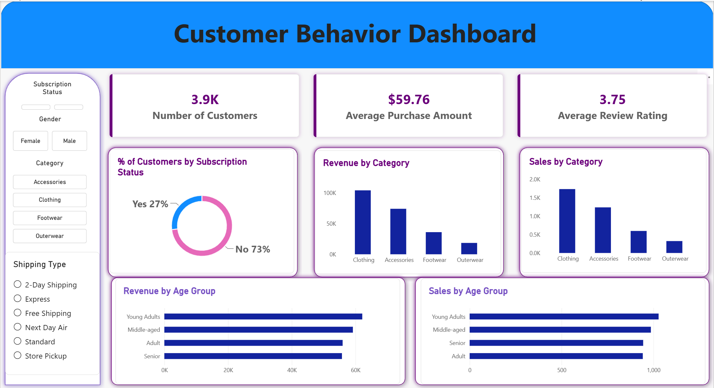

# Customer Shopping Behavior Analysis

An end-to-end retail analytics project that uses Python, MySQL, and Power BI to examine customer purchasing behavior and translate it into practical marketing, loyalty, and merchandising recommendations.

## Overview

The project answers one business question:

> How can a retailer use customer shopping data to identify trends, improve customer engagement, and optimize marketing and product strategies?

The workflow covers data inspection, cleaning, exploratory analysis, SQL analysis, dashboard development, and an executive report.

## Business Problem

Management wants to understand how customer demographics, product categories, seasons, discounts, reviews, subscriptions, payment preferences, and fulfillment choices relate to sales and repeat purchasing.

The analysis focuses on:

- identifying the customer and product segments that contribute the most revenue;
- evaluating whether discounts, ratings, and subscriptions are useful engagement signals;
- finding opportunities to improve loyalty, merchandising, and campaign targeting; and
- highlighting data gaps that limit causal or time-based analysis.

## Dataset

The dataset contains **3,900 customer purchase records** and 18 original fields.

| Area | Example fields |
| --- | --- |
| Customer | Customer ID, age, gender, location, subscription status |
| Product | Item purchased, category, size, color, season |
| Purchase | Purchase amount, discount applied, previous purchases |
| Experience | Review rating, shipping type, payment method, purchase frequency |

Data preparation included:

- imputing 37 missing review ratings with the category median;
- standardizing column names;
- creating age-group and purchase-frequency-day fields; and
- removing `promo_code_used` because it duplicated `discount_applied` in every record.

See the [data dictionary](data/README.md) for field definitions and limitations.

## Tools

- **Python:** pandas, NumPy, Matplotlib, and Seaborn
- **Jupyter Notebook:** exploratory analysis and data cleaning
- **MySQL:** business queries and customer segmentation
- **Power BI:** interactive dashboard and KPI reporting
- **Microsoft Word and PDF:** executive project report

## Steps

1. Loaded the raw CSV with Python.
2. Reviewed data types, summary statistics, missing values, and duplicates.
3. Cleaned the data and created analysis-ready fields.
4. Exported the processed dataset for MySQL and Power BI.
5. Ran SQL queries for revenue, ratings, customer segments, discounts, and repeat buyers.
6. Built a Power BI dashboard with KPI cards, slicers, and category and age-group comparisons.
7. Summarized the findings, recommendations, and limitations in an executive report.

## Dashboard



The dashboard includes:

- 3,900 customers;
- $59.76 average purchase amount;
- 3.75 average review rating;
- subscription, gender, category, and shipping filters; and
- revenue and sales comparisons by category and age group.

Open the [Power BI file](dashboard/customer_behavior_dashboard.pbix) to use the interactive version.

## Results

- **$233,081** in observed revenue was generated across 3,900 records.
- **Clothing** produced $104,264, or **44.7% of total revenue**.
- Clothing and Accessories together contributed **76.6% of revenue**.
- **Young Adults ages 18 to 31** generated the highest age-group revenue at $62,143.
- **27% of customers** were subscribers, but subscriber and non-subscriber average purchases were nearly identical.
- Discounted purchases averaged **$59.28**, compared with **$60.13** without a discount. Discounts should therefore be evaluated with controlled margin tests rather than assumed to increase order value.
- Purchase amount had very weak relationships with review rating and previous-purchase count in this snapshot.
- Payment and shipping preferences were broadly distributed, supporting customer choice rather than a single default option.

## Recommendations

- Build lifecycle campaigns for New, Returning, and Loyal customers using purchase history and stated cadence.
- Protect the Clothing revenue base and use Accessories as the primary cross-sell opportunity.
- Replace broad discounting with customer-level holdout tests that measure incremental contribution margin.
- Investigate high-volume products with below-average ratings, especially Shirts and Blouses.
- Test clearer subscription benefits before increasing subscriber acquisition spending.
- Add transaction date, margin, channel, return, quantity, and acquisition-source fields to future data collection.

## Next Steps and Limitations

The dataset is a cross-sectional snapshot. It does not include transaction dates, product costs, quantities, returns, discount depth, marketing cost, or a true online-versus-store channel field. The observed differences are descriptive and should not be interpreted as causal.

Recommended next steps are to create a dated transaction model, measure cohort retention and customer lifetime value, and validate promotional and subscription decisions through controlled experiments.

## How to Run

### 1. Clone and create a Python environment

```bash
git clone https://github.com/bkhao666/Customer-Trends-Data-Analysis.git
cd customer-trends-data-analysis
python -m venv .venv
```

Activate the environment and install dependencies:

```bash
# Windows
.venv\Scripts\activate

# macOS or Linux
source .venv/bin/activate

pip install -r requirements.txt
```

### 2. Run the Python analysis

```bash
jupyter lab notebooks/customer_behavior_analysis.ipynb
```

Run all cells to recreate `data/processed/customer_behavior_cleaned.csv` and the exploratory analysis.

### 3. Run the MySQL analysis

1. Open MySQL Workbench.
2. Run `sql/create_database.sql`.
3. Import `data/processed/customer_behavior_cleaned.csv` into the `customer` table.
4. Run `sql/customer_behavior_queries.sql`.

### 4. Open the dashboard and report

- Open `dashboard/customer_behavior_dashboard.pbix` in Power BI Desktop.
- Read `reports/customer_shopping_behavior_analysis.pdf` for the executive report.

## Repository Structure

```text
customer-trends-data-analysis/
|-- assets/
|   `-- customer_behavior_dashboard.png
|-- dashboard/
|   `-- customer_behavior_dashboard.pbix
|-- data/
|   |-- raw/customer_shopping_behavior.csv
|   |-- processed/customer_behavior_cleaned.csv
|   `-- README.md
|-- notebooks/
|   `-- customer_behavior_analysis.ipynb
|-- reports/
|   `-- customer_shopping_behavior_analysis.pdf
|-- sql/
|   |-- create_database.sql
|   `-- customer_behavior_queries.sql
|-- .gitignore
|-- README.md
`-- requirements.txt
```

